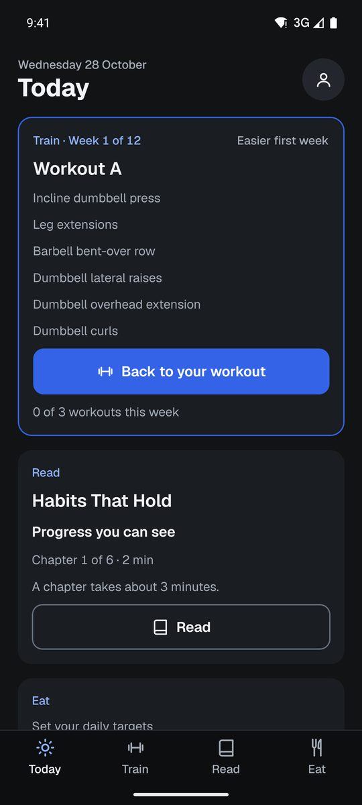
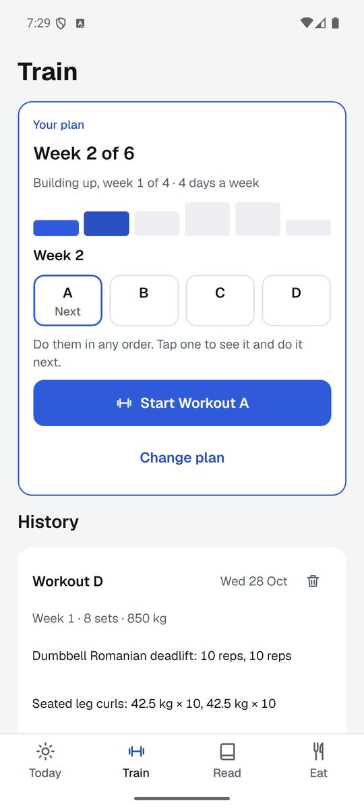
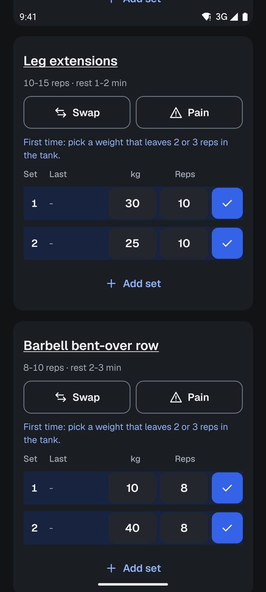
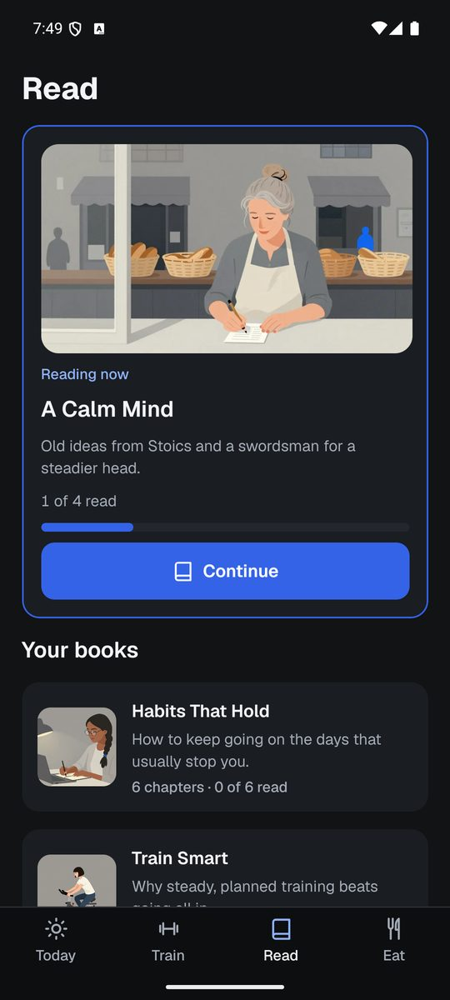
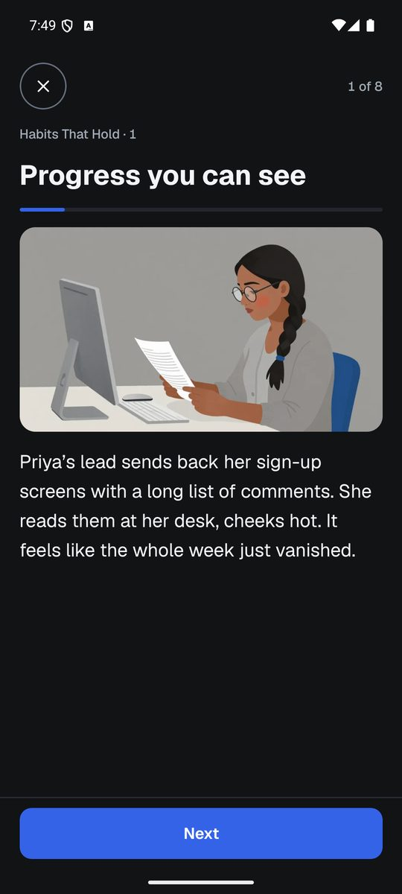
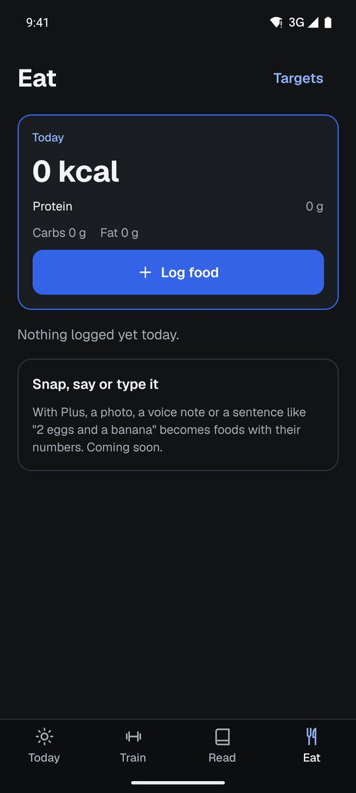

# LevelMeUp

A calm, simple app for building a routine out of three things: **train**, **read** and **eat**. Plain facts instead
of streaks, and a plan that waits for you when life gets in the way.

*LevelMeUp is a working title. The app is in testing on Android.*

<p>
  
  
  
</p>
<p>
  
  
  
</p>

## What it does

**Today** shows the next workout, the chapter you're on and today's food against your targets, one tap from each.

**Train** builds a strength plan from a few questions: your level, 2 to 5 days a week, gym, home or both, and how long
(6 weeks, 12 weeks, a custom length or no end date).
- **Six-week blocks.** Each block has a lighter first week, four weeks that build up a little at a time, and an easy
  week to recover.
- **Any day, any order.** There are no fixed weekdays. The week moves on when its workouts are done, and you can do
  them in any order. Missed days simply wait. After two weeks away, the plan starts again from an easy week.
- **The workout log.** Each set records its weight and reps, with last time's numbers filled in. Each exercise has a
  rest timer and a tip from last time ("Every set hit the top last time, so try 42.5 kg today."). The big lifts also
  get warm-up sets.
- **Gym or home, per workout.** Switch where you train and each exercise is re-picked for that place. Any exercise
  can be swapped for one that works the same muscles.
- **Pain is one tap away** on every exercise. It always offers rest, a gentler swap or stopping.
- **History and best sets** for every exercise.

**Read** is a small library of short books. Each chapter is a story about one person building a habit, told over a
few illustrated cards and ending with one question.

**Eat** logs food by hand: a name, an amount, calories and protein, with your recent foods one tap away. Daily
targets come from your goal and body weight.

It also has a dark and a light look (or follows the phone), a home-screen widget, and optional morning or evening
reminders.

## How it's built

- **App:** Expo SDK 57, React Native, expo-router, TypeScript, zustand and Reanimated, for Android first.
- **Local-first:** everything is saved on the phone (expo-sqlite's key-value store), so the app works offline and
  needs no account.
- **Rules apart from the screens:** plan building, progression and the week's place are plain, tested functions in
  `packages/rules`. Every word the app says lives in `packages/content`, along with its 62 exercises and 5 books.
- **Pictures:** the story pictures (171 of them) are painted in a flat gouache style. A local model (Z-Image Turbo in
  ComfyUI) draws them on the owner's PC with `scripts/art/base-story-art.py`, and the picked set is bundled into the
  app.
- **Accessibility:** every touch target is at least 44 dp, every text pair has at least 4.5:1 contrast, text scales
  with the phone's font size and never cuts off, and there's a reduced-motion path.

| Folder | What's in it |
|---|---|
| `apps/mobile` | The app: screens in `src/base`, routes in `app/`, tests in `test/` |
| `packages/rules` | The plan engine and the other rules, with no React |
| `packages/content` | Copy, exercises, books and story chapters |
| `supabase` | Postgres migrations (row-level security on every table) and Edge Functions from the earlier versions |
| `scripts` | The art pipeline, the daily writing studio, and deploy and check tools |
| `site` | The app's small website |
| `docs` | Plans, designs, research and notes from every iteration |

## How it got here

LevelMeUp went through a few versions in October 2026 before settling on the simple app above.

1. **An anime RPG for self-improvement** (from 10 October). Real-life daily quests, a class, stats, XP and levels,
   a dark "Shadow" to beat, a daily article, and opt-in accountability. It ran on Supabase with server-side
   progression and AI-written quests and articles. It was built in milestones M1 to M17, each on its own branch.
2. **Lantern and story decks** (18 to 20 October). A warmer look, story lessons with a recurring cast, and a daily
   studio that writes a new story each morning.
3. **Monster Week, then Grumble Camp** (25 to 27 October). Cute clay monsters, a buddy and a camp, kept at the tag
   `grumble-camp-0.14.1`.
4. **The base app** (from 28 October, branch `base-app`). The game is gone, and what's left are three plain tools
   for a routine. It has the Graphite look and the gouache pictures.

The earlier versions stay in the branches and the docs. Some of their server pieces are still in `supabase/` and some
of their screens are still in the app code, unreachable, until a clean-up.

## Running it

```bash
npm install
npm test            # every workspace's tests
npm run typecheck
```

The app needs a development build, not Expo Go. Build one with EAS (`npx eas-cli@latest build --platform android
--profile development` from `apps/mobile`), then run `npm run app`. `npm run check:bundle` fails if a secret or
developer-only code would ship in a release bundle.

The app holds only Supabase's publishable key, which is meant to be public and is limited by row-level security.
Service keys and AI keys live only on the server and are never committed.

## License

No license yet: all rights reserved.

Made by [Danny](https://dannytist.com).
